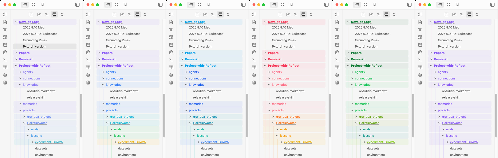

# Neat File Tree

Small quality-of-life tweaks for Obsidian's file explorer that make a deep, busy
vault easier to navigate.

<p align="center">
  
</p>

<p align="center"><sub>Sticky folder headers + the six built-in color schemes (Aurora, Rainbow, Ocean, Sunset, Forest, Mono)</sub></p>

## Features

- **Sticky folder headers** — parent folders pin to the top as you scroll,
  stacked by depth, just like VSCode's "sticky scroll". You never lose track of
  where you are when many folders are expanded.
- **Per-depth color schemes** — folder names, their bar, and the indentation
  guide lines are colored by depth from a scheme you pick: **Rainbow** (the
  default), **Aurora** (anchored to your theme's accent), **Ocean**, **Sunset**,
  **Forest**, or **Mono** — chosen from a live preview in settings. Top-level
  folders stay bold so the roots of your vault stand out.

- **Reveal on open** — opening or switching to a file scrolls the tree to it and
  seats it just below its sticky ancestor stack, with a brief accent pulse.
  Clicking a pinned sticky header jumps to that folder's real row.
- **`nft:` links** — link to a path from inside a note to reveal it in the file
  tree **without navigating**:

  ```markdown
  [My projects](nft:Work/Projects)
  [A note](nft:Work/Projects/Roadmap.md)
  ```

  Clicking scrolls and pulses that file or folder in the tree; the note you're
  reading stays put. The link is drawn in your colour scheme's colour for the
  **depth it points at**, so it matches the row it reveals, with a dotted
  underline and a ▸ marker to set it apart from a normal link. Percent-encode
  spaces (`Work%20Notes`) or wrap the target in angle brackets
  (`[x](<nft:Work Notes>)`). Works in Reading view and Live Preview.

Each feature has its own toggle in the plugin settings, plus a **Row height**
field to keep the sticky headers aligned if you use a larger interface font.

## Install

In Obsidian: Settings → Community plugins → Browse → search "Neat File Tree" →
Install → Enable.

## How it works

The look is CSS toggled by body classes — no DOM manipulation, no performance
cost. The scroll behaviors are a thin layer of plain JS on top. It respects your
theme's accent color (`--text-accent`) and
background variables, so it adapts to light/dark and custom themes
automatically.

## License

MIT
